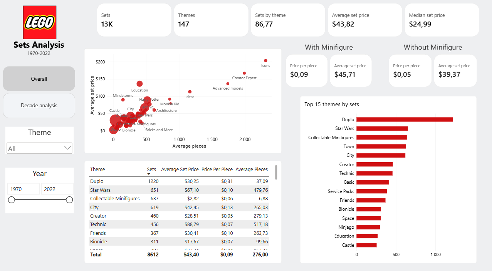

# LEGO Sets Analysis (1970–2022)

## Project Overview

This project explores LEGO sets released between 1970 and 2022 using Power BI. The goal is to identify trends in LEGO set production, examine changes in set size and pricing over time, and compare different LEGO themes.

The analysis focuses on annual release trends, differences between themes, the relationship between minifigures and set prices, and the characteristics of licensed and non-licensed themes.

## Objectives

The main objectives of this project are:

- Analyse changes in the number of LEGO sets released over time.
- Examine trends in set size and pricing.
- Compare the number of sets released across different LEGO themes.
- Investigate whether sets containing minifigures are more expensive.
- Compare licensed and non-licensed themes.
- Identify themes with the highest average set prices and price per piece.

## Tools & Technologies

- **Power BI** – data visualisation, dashboard development and interactive analysis.

## Dataset

The dataset contains information about LEGO sets released between 1970 and 2022.

The analysis includes information such as:

- Set release year
- LEGO theme
- Set price
- Number of pieces
- Minifigure availability

*Dataset source: https://mavenanalytics.io/data-playground/lego-sets*

## Dashboard Preview

### Overall Analysis

The overview dashboard presents key statistics about LEGO sets, including the number of sets and themes, average and median set prices, and comparisons between different themes.

### Decade Analysis

The decade analysis focuses on changes in LEGO production over time, including the number of sets released, average and median piece counts, and the development of LEGO themes.

## Key Findings

### 1. Growth in the Number of LEGO Sets

- The number of LEGO sets released annually increased significantly between 1970 and 2019.
- Since 2019, the number of new releases has remained relatively stable, at approximately 500 sets per year.
- The number of themes followed a similar trend, reaching around 30–35 annually from 2019 onwards.

### 2. Increasing Set Size and Price

- LEGO sets have generally become larger over the years, with both average and median piece counts showing an upward trend.
- The analysis also indicates an increase in average set prices over time.
- The trend towards larger sets is particularly noticeable in recent years.

### 3. Impact of Minifigures on Set Prices

Sets containing minifigures have higher average prices than sets without them.

| Metric | With Minifigures | Without Minifigures |
|---|---:|---:|
| Average Set Price | $45.71 | $39.37 |
| Average Price per Piece | $0.09 | $0.05 |

### 4. Differences Between LEGO Themes

- Some of the largest and most expensive sets belong to themes primarily aimed at adult LEGO fans, such as Icons, Creator Expert, Advanced Models and Ideas.
- Despite this, LEGO Duplo has the highest number of sets in the dataset, with 1,220 releases.
- Duplo also has the highest average price per piece among the themes shown in the analysis ($0.31). This may be related to the larger size of individual pieces designed for younger children.

### 5. Licensed vs. Non-Licensed Themes

- Licensed themes based on popular entertainment franchises tend to have higher average set prices than many non-licensed themes.
- For example, Star Wars has an average set price of $67.10, compared to $42.45 for City.
- Licensing, brand recognition and the nature of the products may contribute to these price differences.

## Interactive Features

The Power BI dashboard includes:

- Theme selection
- Year range filtering
- Overall analysis and decade analysis views
- Interactive charts and tables for exploring LEGO set characteristics

## Conclusions

The analysis shows how LEGO's product portfolio has evolved over more than five decades. The number of annual releases, set sizes and prices have generally increased, while the number of themes has stabilised in recent years.

The comparison between themes also highlights differences in product characteristics. Adult-oriented themes tend to feature larger and more expensive sets, while Duplo leads in the number of releases and average price per piece. Sets containing minifigures also show higher average prices than those without them.

This project demonstrates the use of Power BI to explore historical data, identify trends and communicate analytical findings through interactive visualisations.
