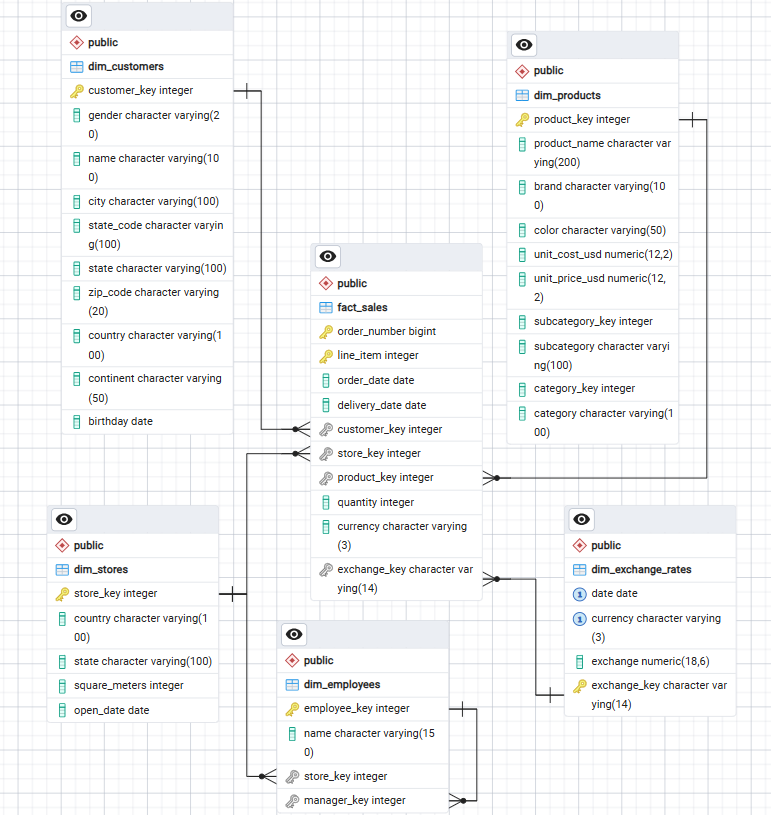

# Retail Sales Analysis

## Project Overview 

This project focuses on analyzing sales data from a fictional electronics retail company. The analysis aims to answer key business questions about sales performance, compare results across stores, identify the best-selling products, and explore different customer segments.

The dataset contains information about sales transactions, products, customers, stores, and currency exchange rates. The original data was obtained from Maven Analytics. I also extended the dataset by creating an additional employee table representing the store workforce and management hierarchy.

## Tools & Technologies

- **Microsoft Excel** — initial data inspection
- **Power Query** — data cleaning and transformation
- **PostgreSQL** — relational database and SQL analysis
- **pgAdmin 4** — database management and query execution

## Project Workflow

1. **Data Acquisition** — obtaining the original dataset from Maven Analytics.
2. **Initial Data Inspection and Cleaning** — reviewing and cleaning the data using Power Query.
3. **Data Modeling and Preparation** — transforming the data and preparing it for database import.
4. **Database Creation** — designing and creating tables, primary keys, foreign keys, and relationships.
5. **Data Import** — loading the prepared data into PostgreSQL.
6. **Employee Data Generation** — generating synthetic employee records for individual stores and establishing reporting relationships between employees and their managers.
7. **SQL Analysis** — developing and executing SQL queries to investigate sales performance and solve analytical problems.

## Database Structure

The database includes the following tables:

- `fact_sales` — sales transactions and order line items
- `dim_customers` — customer information
- `dim_products` — product details and categories
- `dim_stores` — store information
- `dim_exchange_rates` — currency exchange rates
- `dim_employees` — employee information and management hierarchy

The database follows a dimensional modeling approach, with a central sales fact table connected to supporting dimension tables.

The additional `dim_employees` table also enables recursive SQL queries for exploring employee reporting structures.

## Repository Structure

- `SQL/01_raw_data/` — original CSV files obtained from Maven Analytics.
- `SQL/02_data_preparation/` — data prepared in Power Query for database import, SQL scripts for creating tables and relationships, and screenshots documenting the data preparation process.
- `SQL/03_analysis/` — SQL queries developed for sales analysis and additional analytical challenges.

## Entity Relationship Diagram

The following diagram illustrates the database structure,
including the relationships between the sales fact table
and the dimension tables.

## SQL Analysis

The project includes several SQL analyses covering sales performance, customer behaviour, order delivery, and employee management structures.

| SQL Script | Description |
|---|---|
| `store_overview.sql` | Compares store performance based on store size, number of orders, customers and employees, as well as average, median, minimum and maximum order values. |
| `year_over_year_sales.sql` | Calculates annual sales values and compares them with the previous year, including absolute and percentage year-over-year changes. |
| `customer_retention.sql` | Calculates annual customer retention rates by measuring the percentage of customers who make a purchase in the following calendar year. |
| `consecutive_customer_purchases.sql` | Identifies customers who made purchases in at least three consecutive years, with sequences ending in the latest available year (2021). |
| `employee_hierarchy.sql` | Explores employee reporting structures by identifying hierarchy levels and generating management paths from employees to their subordinates. |
| `order_with_delivery.sql` | Analyses the number of orders with a recorded delivery date across different countries. |

## SQL Topics

The project will cover a range of SQL techniques, including:

- Data filtering, aggregation, and sorting
- Joins and subqueries
- Window functions
- Gaps and islands problems
- Histograms and data distributions
- Recursive queries and employee hierarchies
- Business-oriented sales analysis

## Key Findings

1. Sales Performance
- Sales increased steadily between 2016 and 2019, reaching approximately $18.26 million in 2019.
- The strongest year-over-year growth occurred in 2018, when sales increased by 72.32% compared to 2017.
- In 2020, sales declined by 49.11%, falling to approximately $9.29 million.
- In 2021, sales decreased further by 88.82%, reaching approximately $1.04 million. This result should be interpreted with caution, as the available data may cover only part of the year.
2. Store Performance
- The online sales channel recorded 5,580 orders from 4,547 customers, making it the largest sales channel in the dataset by order volume.
- Among physical store locations, Nebraska recorded the highest number of orders (629), followed by South Carolina (624), Nevada (622), and Oregon (619).
- Average order values varied considerably across locations. For example, Mayotte recorded an average order value of $2,791.10, while Armagh recorded $1,849.15.
- The highest average order value was observed in Northwest Territories ($3,794.00), although this location had only four orders.
- Nine physical store locations recorded no orders or customers during the analysed period, despite having employees assigned to them.
- In many locations, average order values were considerably higher than median values, suggesting that high-value orders may influence average order amounts.
3. Customer Retention
- Customer retention increased from 20.7% in 2016 to 46.6% in 2018, indicating an improvement in repeat purchasing behaviour during this period.
- Retention declined to 28.5% in 2019 and dropped further to 4.1% in 2020.
- The sharp decline in 2020 may indicate difficulties in retaining customers, although data completeness and the observation period should be considered when interpreting this result.
- Retention for 2021 was not calculated because data for the following year was unavailable.
4. Consecutive Customer Purchases
- The analysis identified customers who made purchases in at least three consecutive calendar years, with all identified sequences ending in 2021.
- At least two customers made purchases in every year from 2016 through 2021, representing six consecutive years of purchasing activity.
- Other identified customers maintained consecutive purchasing activity for three to five years.
- The analysis demonstrates how the Gaps and Islands technique can be used to identify continuous patterns in customer purchasing behaviour.
5. Employee Hierarchy and Order Delivery
- Recursive SQL queries were used to reconstruct employee reporting structures, identify hierarchy levels, and generate management paths.
- Order delivery analysis was used to examine the distribution of orders with recorded delivery dates across different countries.

## Project Status

The database structure and data preparation process are being developed, followed by data validation and SQL analysis. The repository will be updated as new analyses are completed.
